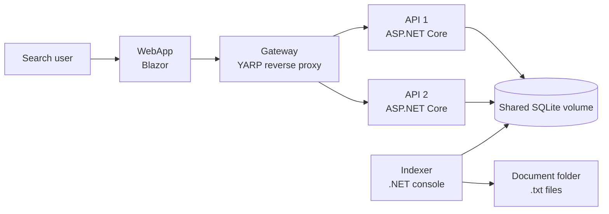
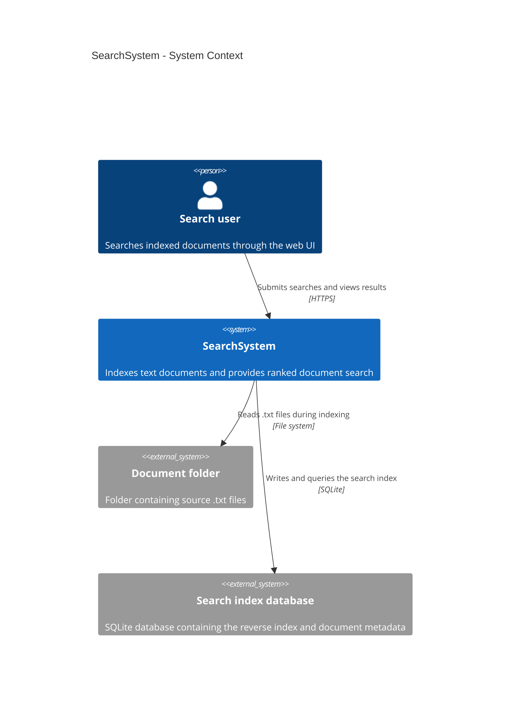
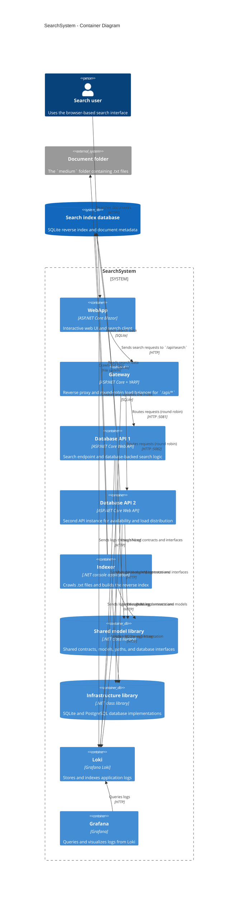
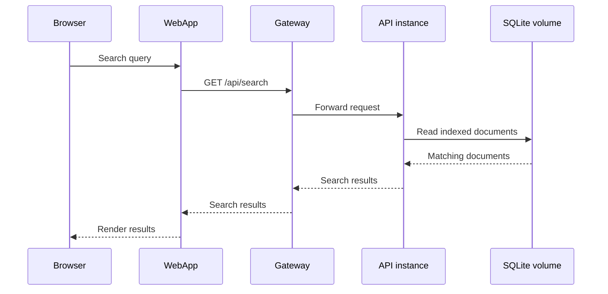
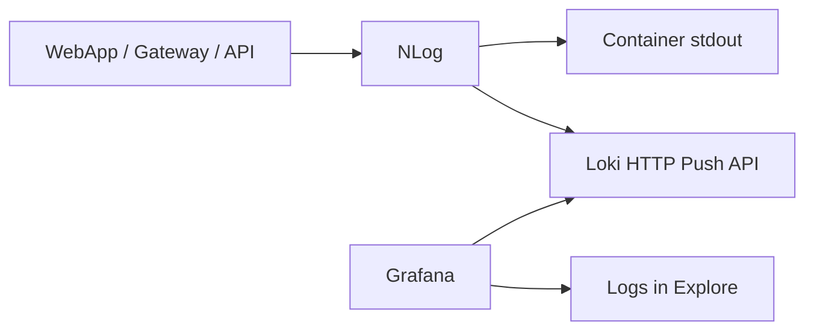

# SearchSystem Architecture

This document describes the containerized SearchSystem solution started with
`docker compose up --build`.

## System Overview



The WebApp is the browser-facing application. It sends search requests to the
Gateway, which distributes `/api/*` requests between the two API containers.
Both API containers read the same SQLite database from the `search-data`
Docker volume. The Indexer builds the reverse index from text documents.

## C4 Context



## C4 Containers



## Request Flow



## Logging Flow



Each ASP.NET Core application uses `NLog.Targets.Loki`. NLog sends structured
JSON logs directly to Loki and also writes them to stdout. The `SERVICE_NAME`
environment variable is written as the Loki `service` label, which makes it
possible to filter logs in Grafana:

```logql
{service=~"api-1|api-2|gateway|webapp"}
```

Promtail is not used. The applications send logs directly to Loki through the
Docker-internal address `http://loki:3100`.

## Docker Services and Ports

| Service | Internal port | Host port | Responsibility |
| --- | ---: | ---: | --- |
| `webapp` | `8080` | `5002` | Browser-facing Blazor UI |
| `gateway` | `8080` | `5000` | Reverse proxy and API load balancing |
| `api-1` | `8080` | - | Search API instance |
| `api-2` | `8080` | - | Search API instance |
| `loki` | `3100` | `3100` | Log storage and query API |
| `grafana` | `3000` | `3000` | Log visualization |

## Persistence

| Volume | Used by | Purpose |
| --- | --- | --- |
| `search-data` | `api-1`, `api-2` | Shared SQLite search database |
| `loki-data` | `loki` | Persistent log data |
| `grafana-data` | `grafana` | Grafana state and configuration |

The two API containers share the same SQLite volume. This is suitable for the
current proof of concept. A production deployment would typically use a
database designed for concurrent multi-instance access, such as PostgreSQL.

## Runtime Ports

| Container | Address | Role |
| --- | --- | --- |
| WebApp | `http://localhost:5002` | Browser-facing search UI |
| Gateway | `http://localhost:5000` | Reverse proxy |
| Database API 1 | Internal only | Search API instance |
| Database API 2 | Internal only | Search API instance |
| Loki | `http://localhost:3100` | Log ingestion and query API |
| Grafana | `http://localhost:3000` | Log dashboards and Explore |

## Startup

```powershell
docker compose up --build
```

Open the WebApp at `http://localhost:5002` and Grafana at
`http://localhost:3000`. Grafana is provisioned with Loki as its datasource.
